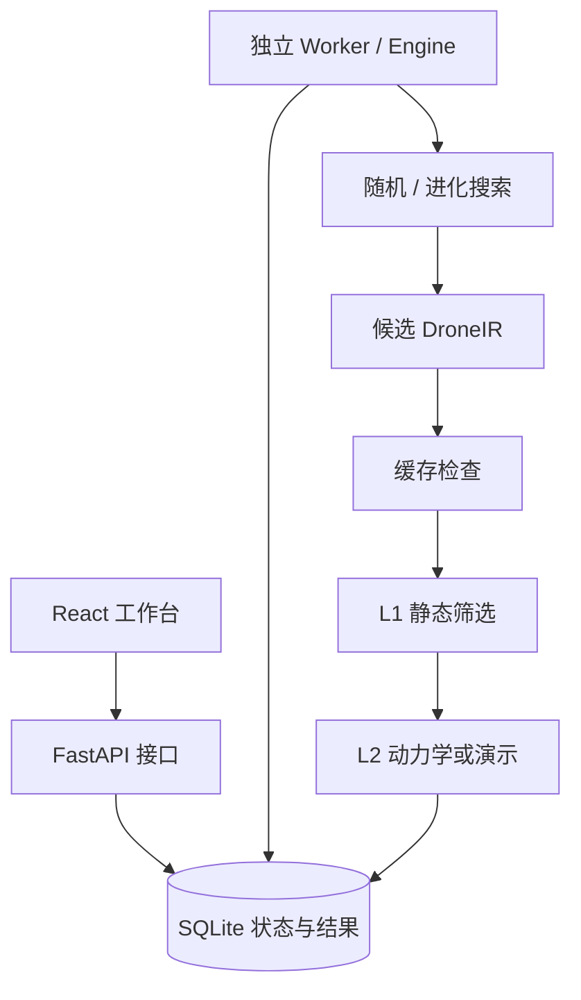
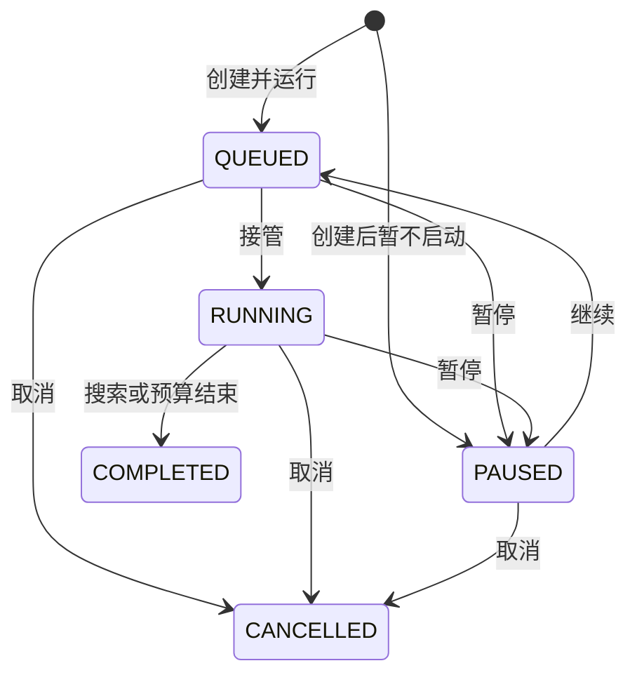

# 工程架构

本页描述 v0.3.0 的当前实现；待开发功能集中在 [开发路线](../development/roadmap.md)。

## 目标与范围

平台面向多旋翼的参数化构型探索，提供候选生成、分层评估、寻优和复盘。产出为构型、指标、实验记录与轨迹，不包含硬件采购、制造或真机部署。

## 模块与部署

前后端在同一仓库，API 与 Worker 独立运行。生产前端由 API 同源托管，开发时 Vite 代理 `/api`。每个 SQLite 数据库只有一个 Worker，文件锁防止重复编排。

| 模块 | 代码位置 | 职责 |
|---|---|---|
| 数据契约 | [domain.py](../../apps/backend/drone_lab/domain.py) | 实体、字段和输入校验 |
| API | [api.py](../../apps/backend/drone_lab/api.py) | 创建、查询、控制、详情和导出 |
| 编排 | [orchestration.py](../../apps/backend/drone_lab/orchestration.py) | 漏斗、预算、缓存与恢复 |
| 存储 | [storage.py](../../apps/backend/drone_lab/storage.py) | 数据表与事务 |
| 优化 | [optimizers.py](../../apps/backend/drone_lab/optimizers.py) | 随机提案、进化策略重建 |
| 物理适配 | [core_adapter.py](../../apps/backend/drone_lab/core_adapter.py) | 契约转换、评估和运行参数 |
| 物理核心 | [dronedesign](../../apps/backend/dronedesign/) | 质量特性、配平、动力学、控制与进化 |
| 演示及评价 | [evaluators.py](../../apps/backend/drone_lab/evaluators.py) | 演示评估、缓存键、约束与帕累托 |
| 工作台 | [前端源码](../../apps/web/src/) | 配置、监控、控制、详情与轨迹 |

`dronedesign` 是正在使用的核心包；`drone_lab` 统一管理持久化实验状态。

## 数据契约

| 实体 | 内容 |
|---|---|
| DesignGoal | 搜索空间、约束、目标与预算 |
| DroneIR | 参数确定的飞机 |
| TestScenario | 任务、环境、故障与随机化 |
| ExperimentRequest / ExperimentRun | 配置快照及运行状态 |
| CandidateRecord | 方案在实验中的序号、代数和结果 |
| EvalResult / EvaluationRecord | 单层指标、版本、产物和缓存信息 |
| AttemptRecord | 实际派发的状态、时间与诊断 |
| CandidateDetails | 参数、请求、评估和尝试的查询视图 |
| RevisionRequest | 父方案哈希和修订构型 |

应用契约以 Pydantic 为准，生成 [JSON Schema](../../schemas/) 与 [TypeScript 类型](../../apps/web/src/contracts.ts)。核心内部契约由适配层转换，HTTP 接口采用应用契约。

统一使用 kg、m、s、rad、N，能量为 Wh，功率为 W。机体系为 FRD，世界坐标为 NED，四元数按 wxyz 存储。

工作台从 `/api/defaults` 获取动力学与进化配置；为兼容旧请求，`ExperimentRequest` 缺少模式/优化器时仍按 demo/random 解释。新 API 调用应显式指定这两个字段。

## 状态与恢复

Worker 在短事务中选择实验、推进候选序号、预占预算并记录尝试。评估在事务外执行，再提交结果、缓存、候选状态和事件。暂停阻止新任务，已派发任务可归档。

实际执行按“至少一次”处理，候选以 `(run_id, proposal_index)` 唯一，评估以 `(candidate_id, level)` 唯一。重启时未完成尝试标记为 INTERRUPTED，已用预算保留，按剩余预算继续未完成层级。

随机搜索由种子、序号和实现版本决定提案。进化搜索按已完成代的持久化结果重建策略，当前代提案在内存中加速，批次按 run_id 隔离。

手动修订追加候选，保存 `source=manual_revision` 和 `parent_ir_hash`。候选显示序号统一分配，算法提案序号单独保持，不让手动记录进入进化种群反馈。显式提交的修订可在原实验暂停或完成后执行，保持其生命周期不变，沿用原场景和剩余执行预算；取消会停止尚未完成的手动任务。数据库以增加列方式兼容既有候选。

前端 `workbench/state.tsx` 统一管理选中、悬停、抽屉、视角和独立草稿。Three.js 懒加载，模型按 DroneIR 更新，FRD 映射为显示坐标 `[Y,-Z,-X]`，拆解只改变显示位置。卸载时释放渲染器、控制器和 GPU 资源；不可用时回退到参数操作界面。

## 缓存、预算与存储

应用缓存键包含应用 DroneIR 哈希、Schema 版本、完整场景、层级、评估器版本和随机种子。哈希排除实验名称等运行信息；应用层不额外归一化旋翼排列等物理等价关系。

缓存保存用户约束应用前的原始物理结果，命中后按当前目标重筛。CRASHED/TIMEOUT 不入缓存。评估行为或产物变化应升级评估器版本。

目标适应度评分在缓存之外按当前目标计算；尚缺少目标指标的通过层级不生成完整评分。手动修订与算法候选复用相同缓存和预算规则。

预算按实际派发计数，缓存命中免费，中断尝试仍计入。时限按 RUNNING 墙钟时间累计，暂停不计时，Worker 离线期间仍计时。动力学单次截止取实验剩余时限和 30 秒的较小值。

SQLite 保存实验、候选、评估、尝试、缓存及事件；回放帧随评估结果保存。数据库保留全部事件，当前详情和报告仅返回最近 100 条事件。

## 评估与寻优

| 路径 | 实现 |
|---|---|
| 动力学 L1 | 质量/重心和平行轴惯量合成、控制矩阵求秩、有界悬停配平、功率与桨盘间距 |
| 动力学 L2 | 6-DOF 刚体、一阶电机、级联 PID、风场、故障、机身质量/惯量随机化 |
| 演示 | 简化静态公式和合成跟踪误差，保留 DEMO 标记 |
| 优化 | 随机搜索或 (μ+λ) 进化及加权评分，另计算帕累托前沿 |
| L3 | 尚未接入 |

任一随机化试验失稳都会使整体失败。轨迹保存名义试验，最多 601 帧；随机化试验仅聚合指标。运行参数记录名义质量、合成重心/惯量和实际增益。

## 能力边界

- 动力学控制器支持竖直推力的 4–8 旋翼和级联 PID。L1 可处理偏心与倾斜推力配平，当前动力学请求拒绝倾斜推力构型。
- 机身惯量采用对角输入，电池和载荷按质点合成完整惯量张量，不包含 CAD 或结构有限元。
- 功耗、推力、阻力和电池采用探索级简化模型，无地面效应和桨间气动干扰。
- 随机化当前扰动机身质量和惯量，不等价于完整整机参数随机化。
- 支持容量、单桨推力、机身质量、臂长、桨半径、电机时间常数六个连续搜索参数。容量按固定 180 Wh/kg 联动电池质量。
- 当前提供 JSON 报告、3D 构型拆解/编辑和名义轨迹时间查看，未接入 PDF 报告、Parquet 或三维飞行场景回放。
- 当前没有 L3、Optuna/PyMOO、PostgreSQL/对象存储、分布式队列、账号或多租户系统。

## API 入口

| 方法和路径 | 用途 |
|---|---|
| `GET /api/defaults` | 默认配置与能力 |
| `POST /api/experiments` | 创建实验 |
| `GET /api/experiments` | 列表 |
| `GET /api/experiments/{run_id}` | 实验详情 |
| `POST /api/experiments/{run_id}/{action}` | pause、resume、cancel、retry |
| `GET /api/experiments/{run_id}/candidates/{candidate_id}` | 候选参数与评估记录 |
| `POST /api/experiments/{run_id}/candidates/evaluate` | 提交衍生构型，返回 202，由 Worker 评估 |
| `GET /api/experiments/{run_id}/candidates/{candidate_id}/ir` | 导出构型 |
| `GET /api/experiments/{run_id}/report` | 导出报告 |

完整请求、响应和校验结构以运行后的 <http://127.0.0.1:8000/docs> 为准。
